# PR 3 — Classical Image Processing, YuNet Face Detection & YOLOv8 Object Detection

**Red & White Skill Education · Deep Learning · PR 3 (10 marks)**
**Author:** YOUR NAME · **GRID:** YOUR_GRID

An integrated computer-vision pipeline: cheap classical pre-processing (morphology, bitwise logic, histograms) followed by two deep-learning detectors (YuNet for faces, YOLOv8n for objects), tested on static images and a real-time webcam stream.

## Video
[▶ Watch the video explanation (face + screen)](PASTE_YOUR_VIDEO_LINK_HERE) — file name `CV_PR3_YourName_GRID.mp4`

## Repository structure
```
├── CV_PR3.ipynb          # complete notebook (Restart & Run All, no errors)
├── CV_PR3.html           # HTML export of the executed notebook
├── requirements.txt
├── README.md
├── data/
│   ├── images/           # 10 test images
│   └── models/           # YuNet ONNX + YOLOv8n weights
└── plots/                # all result figures used below
```

## Data & model sources
| Item | Source | License |
|---|---|---|
| lena, fruits, notes (music score), OpenCV logo | [OpenCV sample data](https://github.com/opencv/opencv/tree/master/samples/data) | BSD-3-Clause |
| face_side_profile, face_sunglasses, street, dog_bicycle | [OpenCV extra test data](https://github.com/opencv/opencv_extra/tree/4.x/testdata) | OpenCV test data |
| zidane, bus | Ultralytics sample images ([ultralytics/ultralytics](https://github.com/ultralytics/ultralytics)) | AGPL-3.0 |
| `face_detection_yunet_2023mar.onnx` | [OpenCV Zoo – YuNet](https://github.com/opencv/opencv_zoo/tree/main/models/face_detection_yunet) | MIT |
| `yolov8n.pt` (COCO, 80 classes) | [Ultralytics YOLOv8](https://github.com/ultralytics/ultralytics) | AGPL-3.0 (free for education) |

## Setup & preprocessing steps
1. `pip install -r requirements.txt` (OpenCV 5.0.0, contrib, ultralytics, numpy, matplotlib).
2. Keep images in `data/images` and weights in `data/models` (already included). If the YuNet file is missing the notebook downloads it from the OpenCV Zoo; YOLO weights auto-download.
3. Open `CV_PR3.ipynb` **from the repository root** in Jupyter and choose *Restart & Run All*. `cv2.__version__` is printed to confirm OpenCV 5.0.
4. Pre-processing used: grayscale conversion, inversion + binary threshold (127), synthetic salt-and-pepper noise, large photos resized to ≤ 1000 px, frames resized to 640×480.
5. Webcam tasks use `cv2.VideoCapture(0)`; if no webcam exists a simulated noisy stream is used instead (the notebook prints which source was used).

## The five topics
**Task 1 – Image I/O & Morphology.** Loading gray/colour images, binarisation, erosion, dilation, opening and closing, and a kernel shape × size comparison.
Erosion is a local-minimum filter and dilation a local-maximum filter; opening removes small noise, closing fills small holes.

**Task 2 – Bitwise operations & Histograms.** AND/OR/XOR/NOT on masks, a circular-ROI extraction and logo watermark, gray and B/G/R histograms.
`convertScaleAbs` (alpha = contrast, beta = brightness) is compared through histograms to diagnose exposure before detection.

**Task 3 – Face detection with YuNet.** `cv2.FaceDetectorYN` returns boxes, 5 landmarks and a confidence score in one pass, on images and in real time.
Includes a score-threshold experiment (0.5 / 0.7 / 0.9) and a Gaussian-blur privacy filter applied only inside face boxes.

**Task 4 – Object detection with YOLOv8n.** Pretrained COCO model on static images and a live stream, with FPS.
Confidence/IoU tuning, a duplicate-box vs NMS example and a per-class detection summary.

**Task 5 – Integrated pipeline.** Face (green) and YOLO (red) layers on one stream, optional morphological pre-cleaning, FPS benchmark and a final comparison table.

## Results (plots)
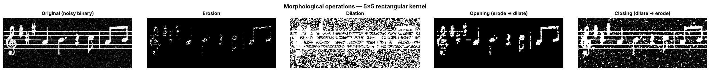
*Task 1.3 – Erosion, dilation, opening and closing (5×5 kernel) on a noisy binary score*

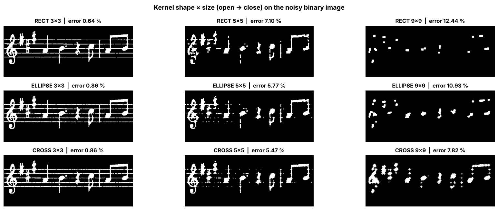
*Task 1.4 – Kernel shape × size (open→close). RECT 3×3 is best: 0.64 % error; 9×9 destroys thin lines*

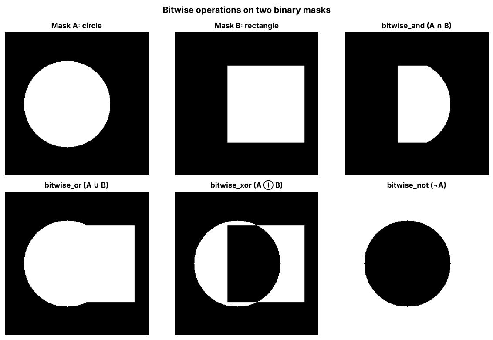
*Task 2.1 – Bitwise AND / OR / XOR / NOT on a circle and a rectangle mask*

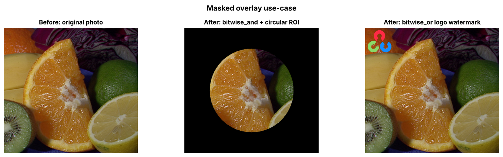
*Task 2.2 – Circular ROI extraction (AND) and logo watermark (OR)*

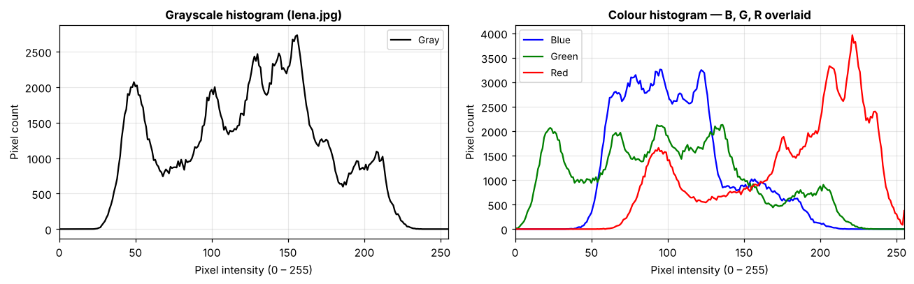
*Task 2.3 – Grayscale and overlaid B/G/R histograms*

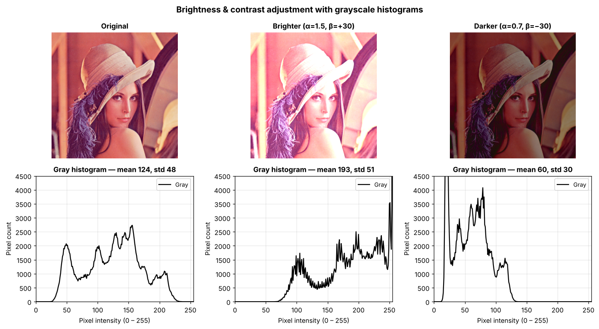
*Task 2.4 – Brightness/contrast adjustment: alpha stretches, beta shifts the histogram; clipping at 255*

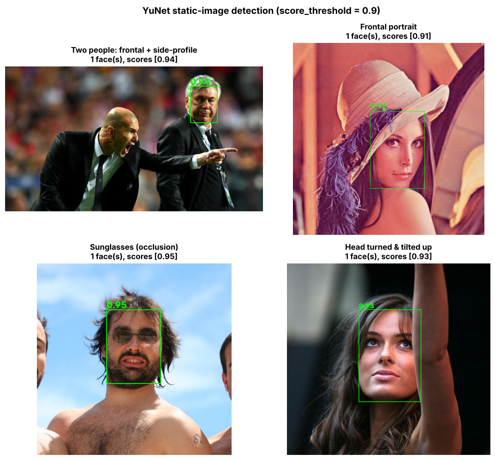
*Task 3.2 – YuNet on frontal, side-profile, sunglasses and turned faces (threshold 0.9)*

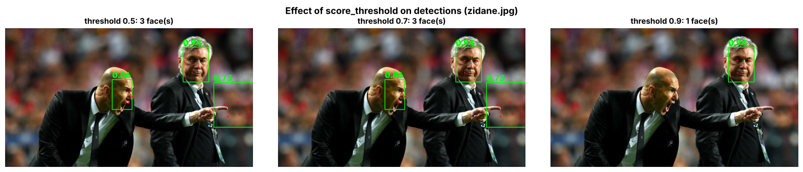
*Task 3.4 – score_threshold 0.5 / 0.7 / 0.9: profile face recovered at ≤ 0.7, but a false positive appears*

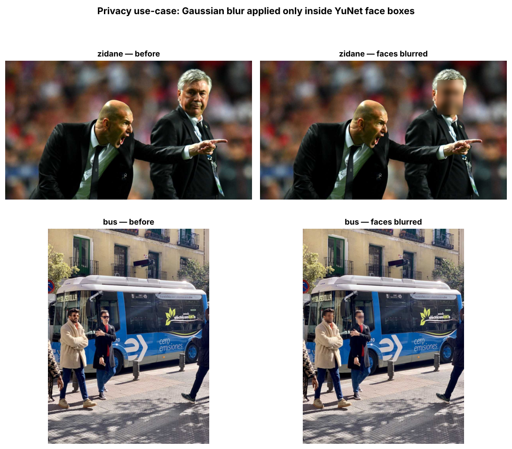
*Task 3.4 – Privacy use-case: blur applied only inside detected face boxes*

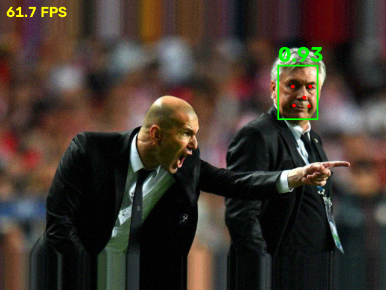
*Task 3.3 – Real-time YuNet frame with FPS overlay*

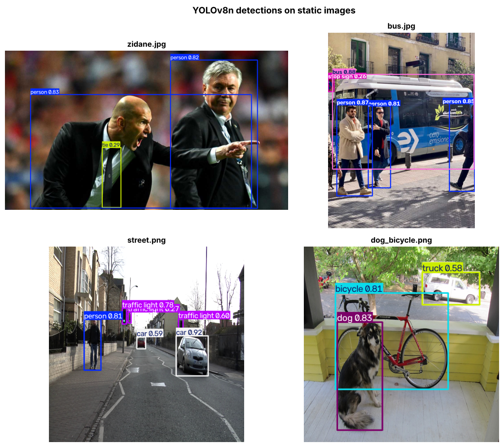
*Task 4.1 – YOLOv8n detections with labels and confidence*

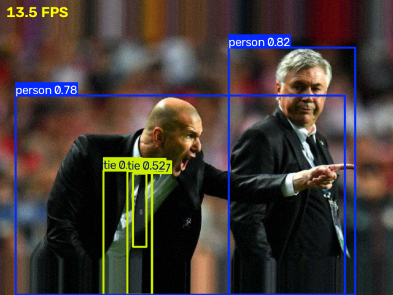
*Task 4.2 – Real-time YOLOv8n frame with FPS overlay*

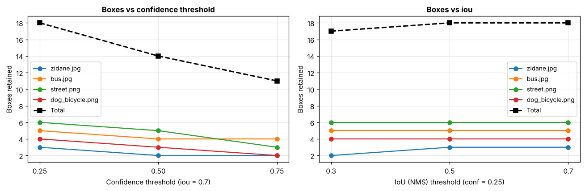
*Task 4.3 – Boxes retained vs confidence and IoU thresholds*

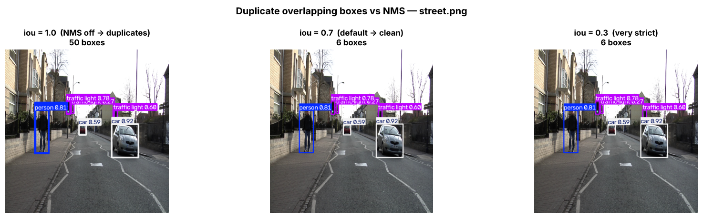
*Task 4.3 – iou = 1.0 (NMS off) gives 50 duplicate boxes vs 6 at the default 0.7*

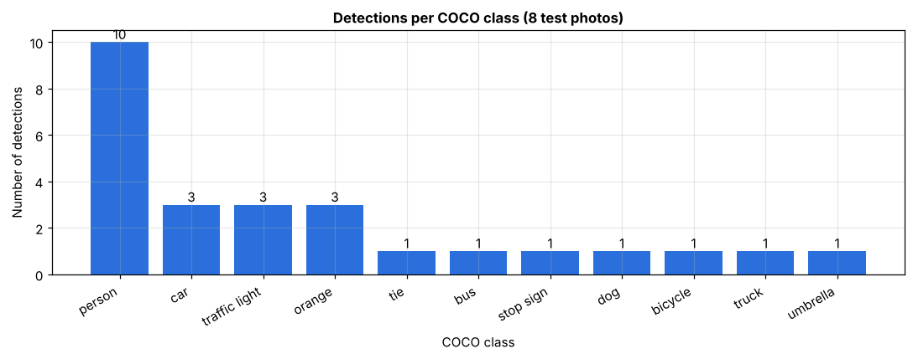
*Task 4.4 – Detections per COCO class over 8 test photos*

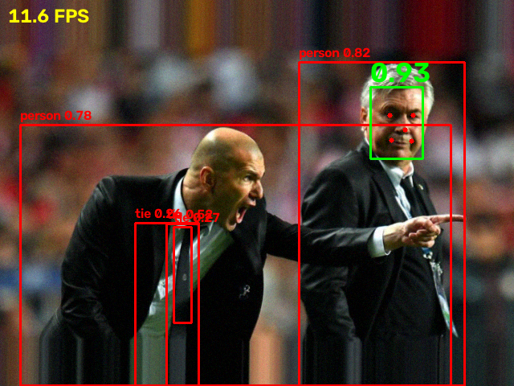
*Task 5.1 – Integrated pipeline: YuNet faces (green) + YOLO objects (red)*

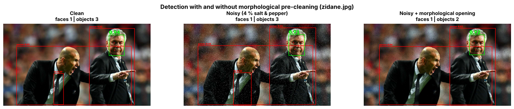
*Task 5.2 – Detection on clean, noisy and noisy + morphological opening frames*

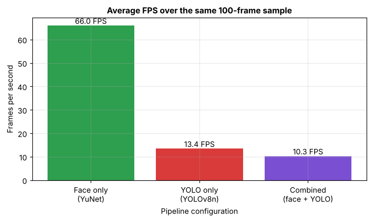
*Task 5.3 – Average FPS over the same 100 frames: face only, YOLO only, combined*

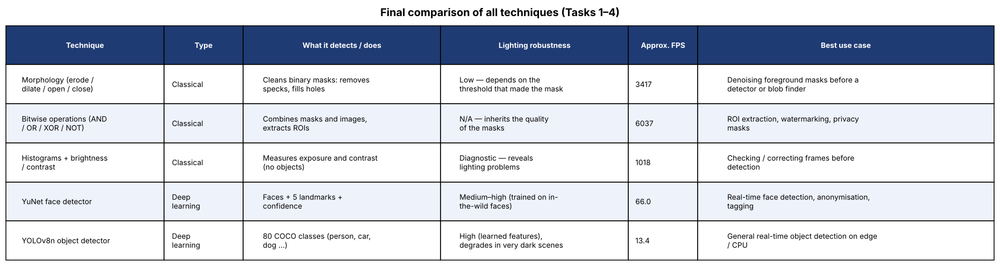
*Task 5.4 – Final comparison table image*


## Final comparison table
| Technique | Type | What it detects / does | Lighting robustness | Approx. FPS | Best use case |
|---|---|---|---|---|---|
| Morphology (erode / dilate / open / close) | Classical | Cleans binary masks: removes specks, fills holes | Low — depends on the threshold that made the mask | 3417 | Denoising foreground masks before a detector or blob finder |
| Bitwise operations (AND / OR / XOR / NOT) | Classical | Combines masks and images, extracts ROIs | N/A — inherits the quality of the masks | 6037 | ROI extraction, watermarking, privacy masks |
| Histograms + brightness / contrast | Classical | Measures exposure and contrast (no objects) | Diagnostic — reveals lighting problems | 1018 | Checking / correcting frames before detection |
| YuNet face detector | Deep learning | Faces + 5 landmarks + confidence | Medium–high (trained on in-the-wild faces) | 66.0 | Real-time face detection, anonymisation, tagging |
| YOLOv8n object detector | Deep learning | 80 COCO classes (person, car, dog …) | High (learned features), degrades in very dark scenes | 13.4 | General real-time object detection on edge / CPU |

*FPS measured on a CPU-only machine on a 640×480, 100-frame simulated stream; values depend on hardware and will differ on your machine.*

## Key observations
- Best morphology kernel for salt-and-pepper noise was **RECT 3×3** (0.64 % error); larger kernels erased thin strokes.
- YuNet at 0.9 missed the side-profile face; at 0.7 it was found (0.86) but a low-confidence false positive also appeared.
- NMS: a high `iou` keeps duplicate boxes (50 at `iou=1.0`), the default 0.7 gives 6 clean boxes.
- Noise lowered detector confidence; a light 3×3 opening recovered most of it (e.g. bus mean confidence 0.56 → 0.72).
- The combined pipeline is slower than either detector alone, and YOLO dominates the cost.

## Tools
Python 3 · Jupyter Notebook · OpenCV 5.0.0 (`cv2`, `cv2.FaceDetectorYN`) · Ultralytics YOLOv8 · NumPy · Matplotlib
